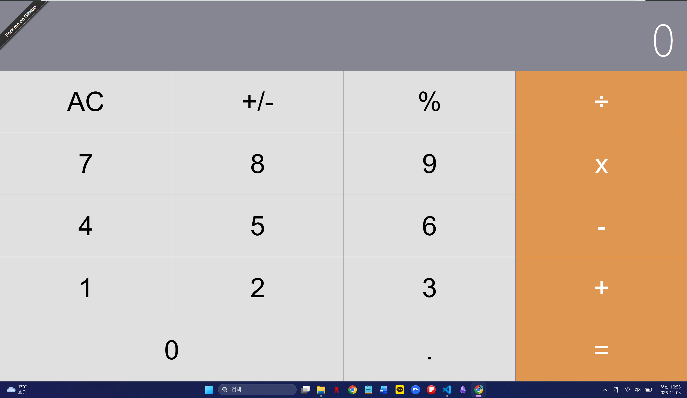
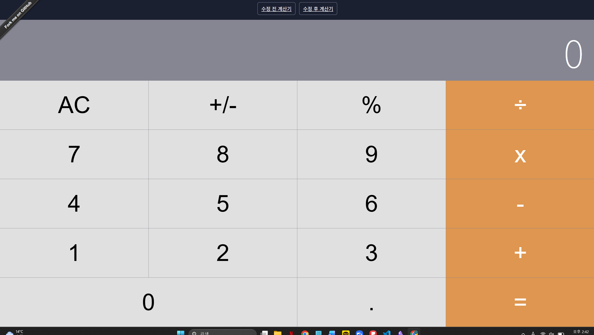
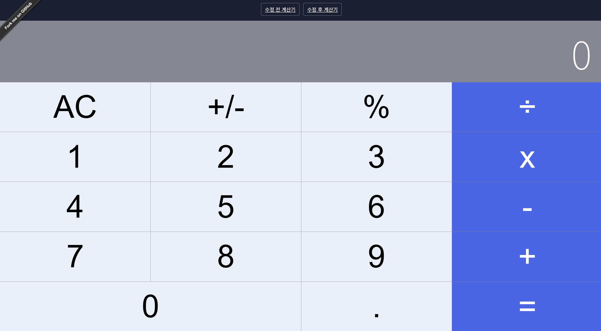

Calculator
---

Created with *create-react-app*. See the [full create-react-app guide](https://github.com/facebookincubator/create-react-app/blob/master/packages/react-scripts/template/README.md).

Try It
---

[ahfarmer.github.io/calculator](https://ahfarmer.github.io/calculator/)

Install
---

`npm install`

Usage
---

`npm start`

# 과제 README

### Project Information: 
- 프로젝트 소개 : 계산기

- 선택 이유 : 사용언어가 JavaScript, CSS, HTML 언어로 이루어져있으며, react를 프레임워크로 사용하고 있기 때문에 선택하였습니다. 또한 라이선스는 MIT 라이선스로 permissiomn이 허용되어있기 떄문에 수정하여 배포하기 위하여 선택하였습니다.

- 원본 GitHub URL 및 라이선스

#### 원본 URL
https://github.com/andrewagain/calculator

#### 라이선스
MIT License

Copyright (c) 2018 Andrew H Farmer

Permission is hereby granted, free of charge, to any person obtaining a copy
of this software and associated documentation files (the "Software"), to deal
in the Software without restriction, including without limitation the rights
to use, copy, modify, merge, publish, distribute, sublicense, and/or sell
copies of the Software, and to permit persons to whom the Software is
furnished to do so, subject to the following conditions:

The above copyright notice and this permission notice shall be included in all
copies or substantial portions of the Software.

THE SOFTWARE IS PROVIDED "AS IS", WITHOUT WARRANTY OF ANY KIND, EXPRESS OR
IMPLIED, INCLUDING BUT NOT LIMITED TO THE WARRANTIES OF MERCHANTABILITY,
FITNESS FOR A PARTICULAR PURPOSE AND NONINFRINGEMENT. IN NO EVENT SHALL THE
AUTHORS OR COPYRIGHT HOLDERS BE LIABLE FOR ANY CLAIM, DAMAGES OR OTHER
LIABILITY, WHETHER IN AN ACTION OF CONTRACT, TORT OR OTHERWISE, ARISING FROM,
OUT OF OR IN CONNECTION WITH THE SOFTWARE OR THE USE OR OTHER DEALINGS IN THE
SOFTWARE.

### Installation: 
- 설치·실행 방법
원본 repository에서 fork 후 -> 자신 repository에서 clone -> npm install -> npm start 를 통해 설치와 실행을 진행

- 실행 화면

### Source Code Exploration
- Project Structure: 주요 파일 2~3개의 역할
operate.js : operation 에 따라 수행할 연산을 지정해놓은 파일입니다. 연산자로는 덧셈, 뺄셈, 곱셈, 나눗셈이 있습니다. 0으로 나누었을 떄의 상황도 처리하기 위하여 divid by 0 에러도 조건문으로 처리하고 있ㅅ브니다. 또한 return 형식은 숫자가 아니라 stiring 으로 변환하여 출력하고 있습니다. 

calculate.js : 
calaulate.js 파일은 operate.js 와 다르게 연산자가 외에 계산기의 기능을 사용하고 있습니다. 예를 들어 A/C 와 마드 또는 소수점을 표현하기 위한 . 표시 그리고 결과를 출력하기 위한 = 표시 등을 지정하고 있는 파일입니다.

- React Component: 주요 컴포넌트 1~2개의 역할
Button.js : 이 컴포넌트의 역할은 버튼의 클릭이 일어났을 때 그 버튼의 이름을 props으로 넘깁니다. 또한 주황색 버튼과 흰색 버튼으로 render 하기위해 조건을 나누고 있습니다.

ButtonPanel.js :이 컴포넌트의 역할은 계산기 화면에 숫자와 연산자 버튼을 배치합니다. 각 버튼에 이름과 클릭처리 함수인 handleClick을 전달합니다. 버튼을 누르면 handleClick이 버튼 이름을 받아 부모 컴포넌트의 clickHandler로 전달합니다.

- Code Analysis: 코드 1개(약 5~15줄)를 선택하여 동작 원리 설명
handleClick = buttonName => {
  this.props.clickHandler(buttonName);
};

render() {
  return (
    

      

        <Button name="AC" clickHandler={this.handleClick} />
        <Button name="+/-" clickHandler={this.handleClick} />
        <Button name="%" clickHandler={this.handleClick} />
        <Button name="÷" clickHandler={this.handleClick} orange />
      

    

  );
}
버튼을 클릭하면 Button 컴포넌트가 버튼 이름을 인자로 전달해 handleClick을 호출한다. 이어서 this.props.clickHandler(buttonName)이 부모에게 전달받은 함수를 실행한다. 
다시 말해서 Button → ButtonPanel → 부모 컴포넌트 순서로 클릭한 버튼의 이름이 전달되며, 
실제 계산 처리는 부모 쪽 로직에서 수행한다.

### Customizing
- 수정한 3가지 내용
계산기의 디자인과 가독성을 개선하기 위해 세 가지를 수정했습니다.
1: src/component/Button.css에서 버튼 색상을 변경했습니다. 수정 전에는 일반 버튼이 회색, 연산 버튼이 주황색이었으나, 수정 후 연한 파란색과 회색으로 수정했습니다.

2: src/component/ButtonPanel.js에서 숫자 버튼의 배치를 변경했습니다.수정 전에는 위에서부터 7·8·9, 4·5·6, 1·2·3 순서였지만, 수정 후에는 1·2·3, 4·5·6, 7·8·9 순서로 배치했습니다.

3: src/component/Button.css에서 버튼의 글자 크기와 안쪽 여백을 조절했습니다. 글자 크기를 1.5rem에서 2rem으로 확대하고, 기존에 없었던 위아래 여백을 12px 추가했습니다.

- 수정 파일명 및 전/후 결과
src/component/Button.css -> 버튼 색상과, 글자 크기 변경
src/component/ButtonPanel.js -> 숫자 버튼 배치 수정 : 수정 전 789->456->123 에서 123->456->789 로 변경 삼항 연산자로 표현

## 수정전 

## 수정 후

### Deployment
- 실제 접근 가능한 Vercel URL : https://calculator-2kd7.vercel.app/

### Weekly Review
- 새롭게 배운 내용 3가지
1 : React에서 props를 통해 컴포넌트 사이에 데이터와 함수를 전달하는 방법을 배웠다. 특히 버튼을 클릭하면 버튼 이름이 Button에서 ButtonPanel을 거쳐 부모 컴포넌트로 전달되는 과정을 이해하였다.
2 : URL의 쿼리 매개변수를 이용해 수정 전·후 화면을 구분하는 방법을 진행
3 : 로컬에서 정상 실행되어도 배포 환경의 Node.js 버전과 파일 경로 설정에 따라 오류가 발생할 수 있다.

- 어려웠던 점과 해결 방법
어려웠던 점은 로컬에서 정상적으로 실행되는 계산기가 Vercel에서는 빌드에 실패하거나 빈 화면으로 표시된 것이었다. 또한 이전 배포 주소와 현재 공개 주소를 혼동하여 수정 결과를 확인하는 데 어려움이 있었다. 이를 통해 로컬 실행과 배포 환경의 차이를 이해하고, 오류 로그와 실제 배포 버전을 확인하는 것이 중요하다는 점을 배웠다.

- AI 활용 내용 및 느낀 점
props 전달에 대한 개념이 어려워서 내용 학습하는데 사용하였습니다. props 는 위에서 아래로 전달되기도 하며, 아래에서 위로 전달되기도 한다. 함수는 props로 내려주고, 자식은 그 함수를 호출해서 부모에게 알리고, 부모는 변경된 값을 다시 자식에게 내려준다. 이 개념에 빠륵 익숙해져야 react 구조를 파악할 수 있을것 같다고 느꼈다.